<div align="center">



**Source-verified on QIE Mainnet · AI + Autonomous Agents · Hackathon 2026**

[](foundry.toml)
[](https://mainnet.qie.digital/)
[](https://mainnet.qie.digital/address/0xb752F05a55059C89a43a289d5d055F303B6DD96E?tab=contract)
[](https://github.com/Makabeez/qie-sentinel/actions/workflows/foundry.yml)
[](https://github.com/Makabeez/qie-sentinel/actions/workflows/agent-ci.yml)

**[Live security lab](https://qie-sentinel-peach.vercel.app/#demo)** · **[Watch 2:59 demo](https://youtu.be/GedB5dSSj8g)** · **[On-chain receipts](https://qie-sentinel-peach.vercel.app/#proof)** · **[Architecture](docs/ARCHITECTURE.md)** · **[Security disclosures](docs/SECURITY.md)**

</div>

## The problem

AI agents can propose payments. They should not hold unilateral authority to spend funds. QIE Sentinel demonstrates a narrow, auditable boundary between **agent proposals**, **human signatures**, and **on-chain enforcement**.

QIE Sentinel is a QUSDC-only, human-authorized AI-agent payment prototype. A local agent interprets payment requests and proposes transactions. Deterministic policy checks reject invalid requests before signing. A separate owner signs an **exact EIP-712 payment intent**; an independent executor submits it to the verified Solidity vault, which checks executor, expiry, QUSDC token, nonce, signature, PolicyGuard budget/allowlist and transfer before settlement.

**Scope:** hackathon MVP, not independently audited, not a production wallet or an unattended treasury manager. The public site does not hold keys, authorize payments, or access the private local dashboard.

## Verified QIE Mainnet deployment

Both contracts have **Contract Source Code Verified** status on the QIE explorer as of **21 November 2026**. Source verification establishes a match to deployed bytecode; it is **not** a security audit.

| Contract | Address | Source |
|---|---|---|
| SentinelVault | `0xb752F05a55059C89a43a289d5d055F303B6DD96E` | [Verified source](https://mainnet.qie.digital/address/0xb752F05a55059C89a43a289d5d055F303B6DD96E?tab=contract) |
| PolicyGuard | `0x532Ee81939386E23b8c58076e643D9FCe489F15C` | [Verified source](https://mainnet.qie.digital/address/0x532Ee81939386E23b8c58076e643D9FCe489F15C?tab=contract) |
| QUSDC | `0x3F43DA82eC9A4f5285F10FaF1F26EcA7319E5DA5` | [Token address](https://mainnet.qie.digital/address/0x3F43DA82eC9A4f5285F10FaF1F26EcA7319E5DA5) |

**Verified compiler configuration:** Solidity 0.8.24, Paris EVM, optimizer enabled, 200 runs. Vault constructor arguments shown on the explorer: QUSDC token, owner `0x395215ab5Dde403801868fa850b89e305F01725E`, executor `0xD0612b00030AC351EAb6A7800E4b7679e3f7D95A`, maximum transfer 1,000,000 raw units, daily limit 5,000,000 raw units.

### Historical transaction evidence

| Action | Result | Explorer proof |
|---|---|---|
| Vault deployment, block 12,006,079 | Confirmed | [Deployment transaction](https://mainnet.qie.digital/tx/0x8edf56430a508d1595e7cdbee0b0187dbcc4bc9a2c07b2683da4f9aef30a8d94) |
| Owner pauses vault | Confirmed | [Pause](https://mainnet.qie.digital/tx/0x6b039508ea4eb6a9c40b97a65ef1eb211b1c7f143e58a5bb144fecad54dcda1d) |
| Owner unpauses vault | Confirmed | [Unpause](https://mainnet.qie.digital/tx/0xdac70752ed0c6dd36593059109c2feb4c7c1519cbe226842016ce6eefcb26e35) |
| Earlier QUSDC payment | 0.25 QUSDC | [Receipt](https://mainnet.qie.digital/tx/0xf26e8863da1d116399bcf3d5cfb8efad378897446da585c16afb2eeaef3d9442) |
| Owner-signed executor payment, nonce 1 | 0.10 QUSDC | [Receipt](https://mainnet.qie.digital/tx/0x196dce5ce2ad7ad2f327eb5ff9d41c171dd0535bbcdb001742832b1862a5d59a) |
| Proposal queue → signed intent → executor, nonce 2 | 0.10 QUSDC | [Receipt](https://mainnet.qie.digital/tx/0x95f122e6b4679727751dd8e111ed4a5892fd9d85d07aa0554fcb1a52127c1b48) |

**Evidence limitation:** These three payments total **0.45 QUSDC** and went to the **same allowlisted wallet** (`0xce99cF8EdfD199dB02b830445d89E746B8c1C7ff`). They prove the payment mechanism executes on mainnet, **not** independent user adoption, a customer base, or meaningful transactional traction. Emergency recovery is implemented and tested locally, but no recovery transaction is claimed on mainnet. Displayed historical receipt counts are not a live vault balance.

## Interactive security lab

The [public website](https://qie-sentinel-peach.vercel.app/#demo) has **five** browser scenarios. They make **real read-only QIE Mainnet RPC requests** and never request a signature or broadcast a payment:

| Scenario | Evidence type | Expected result |
|---|---|---|
| Allowlisted wallet, 0.05 QUSDC | `PolicyGuard.validate` via `eth_call`; `isNonceUsed`; chain timestamp | Eligible for owner approval; not authorized to execute |
| Unknown recipient | `PolicyGuard.validate` `eth_call` | `RecipientNotAllowed` revert data, when exposed by RPC |
| 1.000001 QUSDC | `PolicyGuard.validate` `eth_call` | `TransferLimitExceeded` |
| Previously consumed nonce 1 | `SentinelVault.isNonceUsed(1)` `eth_call` | `true`; rejected in browser assessment |
| Expired intent | Compare proposed deadline with timestamp from `eth_getBlockByNumber` | Expired; rejected in browser assessment |

**Important distinctions:** RPC `eth_call` reverts are **not reverted mined transactions**. Nonce and expiry results are **read-only assessments using mainnet state**, not signed `execute()` attempts. The vault checks the signature before calling PolicyGuard; an invalid unsigned `execute()` would not prove each individual policy rejection. RPC failures produce **unavailable**, not a fabricated result.

## Agent → human → blockchain

```text
Local payment task → deterministic interpreter → live policy preflight
  ├─ invalid → off-chain rejection and SQLite audit
  └─ eligible → unsigned proposal in SQLite queue
                    ↓
       Human owner approves exact EIP-712 Payment
       (separate encrypted Foundry owner keystore)
                    ↓
       Independent executor submits signed Payment
       (different encrypted executor keystore)
                    ↓
       Verified SentinelVault → PolicyGuard → QUSDC
       (nonce bitmap and event receipts)
```

A read-only public demonstration of policy checks **is not the full agent UI**. The agent and its audit history run locally at `127.0.0.1:8765`; this private service must never be exposed to the public internet. The nonce-2 mainnet transaction above documents a completed local proposal→approval→execution workflow. The optional OpenAI risk adviser only provides explanations with explicit consent and cannot change policy or sign.

Read the [architecture and trust boundaries](docs/ARCHITECTURE.md), [security disclosures](docs/SECURITY.md), or [recorded demonstration](https://youtu.be/GedB5dSSj8g).

## Repository guide

| Directory | Purpose |
|---|---|
| [`src/`](src/) · [`test/`](test/) | Deployed Solidity contracts and Foundry security tests |
| [`script/`](script/) | Foundry deployment utilities |
| [`sentinel-agent/`](sentinel-agent/) | **Primary local agent**: proposals, EIP-712 owner workflow, executor, evidence and tests |
| [`site/`](site/) | **Public Vercel showcase** and read-only QIE Mainnet security lab |
| [`docs/`](docs/) | Architecture, security disclosures and demo guide |
| [`scripts/`](scripts/) | Validation, dependency installation and verification utilities |
| [`backend/`](backend/) · [`web/`](web/) · [`tests/`](tests/) | **Legacy proposal-only FastAPI sandbox**; separate from the primary local agent and public site |

The legacy FastAPI sandbox is retained for reproducibility, not used by Vercel and **must not be publicly hosted**. The live site does not connect to either private backend.

## Build and test locally

- Solidity **0.8.24**, OpenZeppelin **5.0.2**, Forge Std **1.9.7**, `evm_version="paris"`.
- Foundry unit, fuzz, invariant and adversarial tests; Python unit tests; GitHub Actions workflows for both. [CI status](https://github.com/Makabeez/qie-sentinel/actions).
- No external independent security audit. No claimed implementation of QIE Wallet, QIE ID, QIEDEX or oracle integrations.

```bash
bash scripts/install-deps.sh
forge build
FOUNDRY_PROFILE=ci forge test -vv
python3 -m unittest discover -s sentinel-agent -p 'test_*.py' -v
python3 scripts/check-public-site.py
node --check site/app.js
```

Run the private dashboard locally only with `python3 sentinel-agent/server.py` or the existing PM2 service; **do not** start an old starter ZIP. No keys are needed for read-only tests.

### Evidence export

```bash
python3 sentinel-agent/demo.py run  # records unsigned / rejected preflight scenarios; does not spend
python3 sentinel-agent/evidence.py --output sentinel-evidence.json
python3 sentinel-agent/showcase.py --input sentinel-evidence.json --output sentinel-showcase.html
```

The exported local JSON contains transaction/proposal data and may be sensitive; keep it out of Git and Vercel. The public website contains curated evidence only.

## Public hosting

Vercel project: **`site/` as Root Directory**, framework preset `Other`, no backend, no environment variables. `site/app.js` performs limited public read-only RPC calls. Do not deploy `sentinel-agent/server.py`, SQLite, encrypted keystores, or local environment files.

**The agent proposes. The owner authorizes. The blockchain enforces.**
