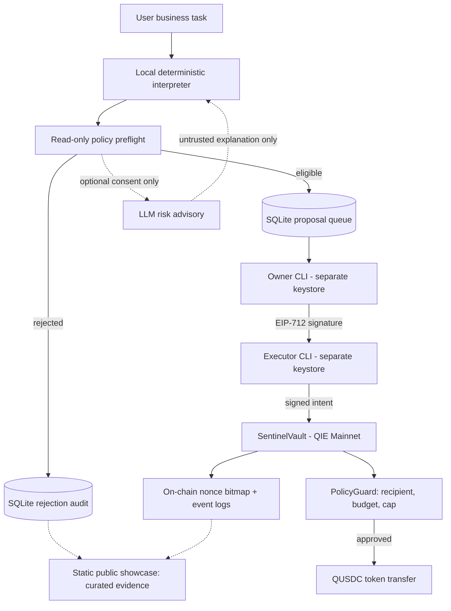

# QIE Sentinel architecture and trust boundaries

## What is running

- **Local private application:** `sentinel-agent/server.py` on `127.0.0.1:8765`, optional OpenAI advisory endpoint, live read-only chain state, local proposal/audit ledger.
- **Independent owner CLI:** `python3 sentinel-agent/agent.py approve <id>`; invokes encrypted `sentinel-owner` Foundry keystore only in the CLI session.
- **Independent executor CLI:** `python3 sentinel-agent/agent.py execute <id>`; explicit confirmation, uses a distinct `sentinel-executor` keystore.
- **On-chain vault:** `0xb752F05a55059C89a43a289d5d055F303B6DD96E` on QIE chain 1990.
- **On-chain PolicyGuard:** `0x532Ee81939386E23b8c58076e643D9FCe489F15C`.
- **Public Vercel showcase:** static files in `site/`. Read-only public QIE Mainnet JSON-RPC (`eth_chainId`, `eth_getBlockByNumber`, allowlisted `eth_call` to the vault and PolicyGuard). No local/private API, signing, transaction broadcast, or key storage.

## Trust-boundary diagram

## Payment authorization

Domain: `QIE Sentinel Vault` / version `1` / chain ID `1990` / verifying contract vault address.

`Payment(address token,address recipient,uint256 amount,uint256 nonce,uint256 deadline,address executor)`

The owner signs the exact digest returned by `paymentDigest(payment)` with Foundry `cast wallet sign --no-hash`. The executor submits `execute(payment, signature)`. Contract checks executor address, deadline, QUSDC token, nonce uniqueness, owner signature (EOA or ERC1271), then consumes PolicyGuard budget and transfers QUSDC. A transaction reverts atomically if any on-chain check fails.

## Operational boundaries

- Keep browser/backend bound to loopback. Do not reverse-proxy the private server to the public internet.
- Keep the owner private key offline except in the interactive CLI signing session.
- Keep demo transactions small; the contracts have not received an independent audit.
- The public site contains a **live read-only policy assessment**, not a connected agent or an execution endpoint. PolicyGuard.validate can revert under eth_call; nonce state is queried from the vault; expiry uses the latest chain timestamp. These are not reverted mined transactions or full signed execute() simulations.
- **Both contracts' deployed source is verified** on QIE Mainnet explorer (21 November 2026; solc 0.8.24, Paris, 200 optimization runs), but this is not an independent security audit. [Vault](https://mainnet.qie.digital/address/0xb752F05a55059C89a43a289d5d055F303B6DD96E?tab=contract) · [Guard](https://mainnet.qie.digital/address/0x532Ee81939386E23b8c58076e643D9FCe489F15C?tab=contract).
